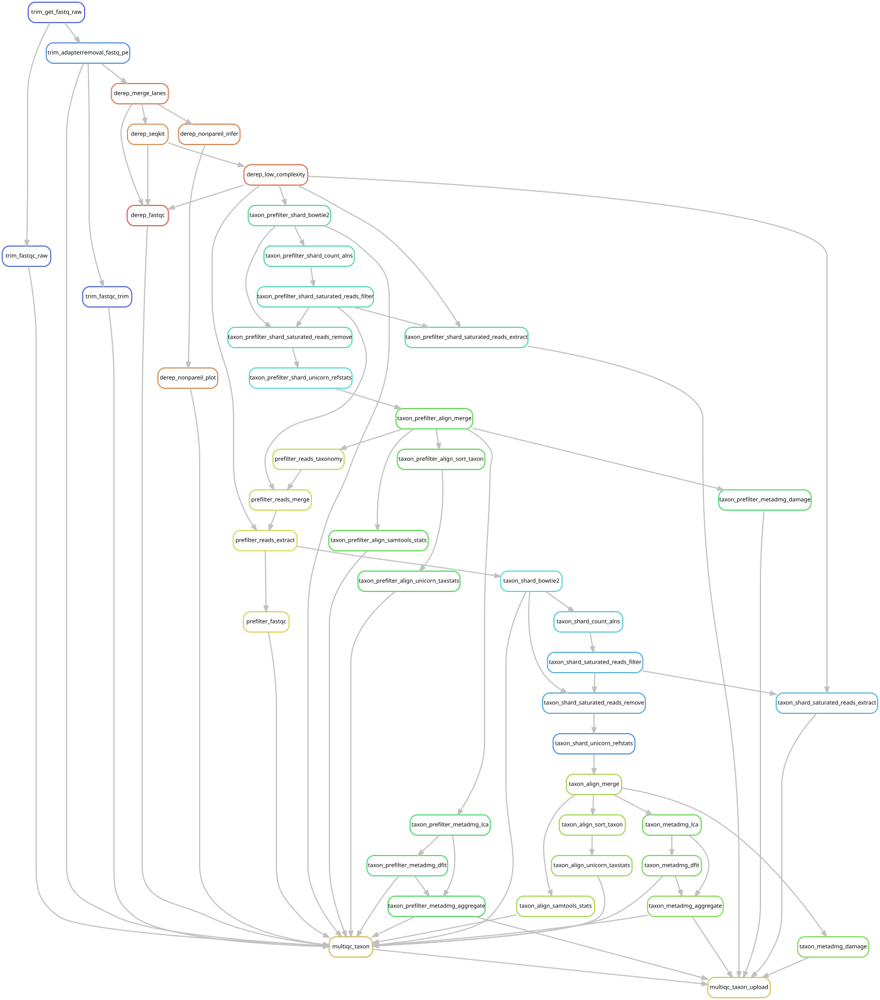
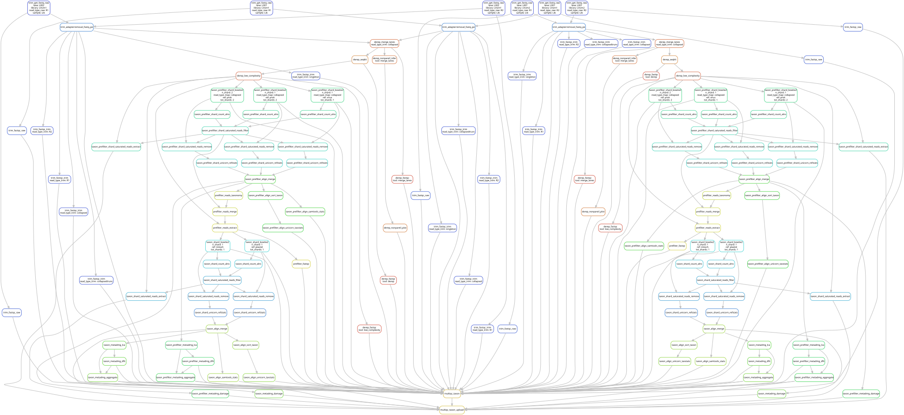
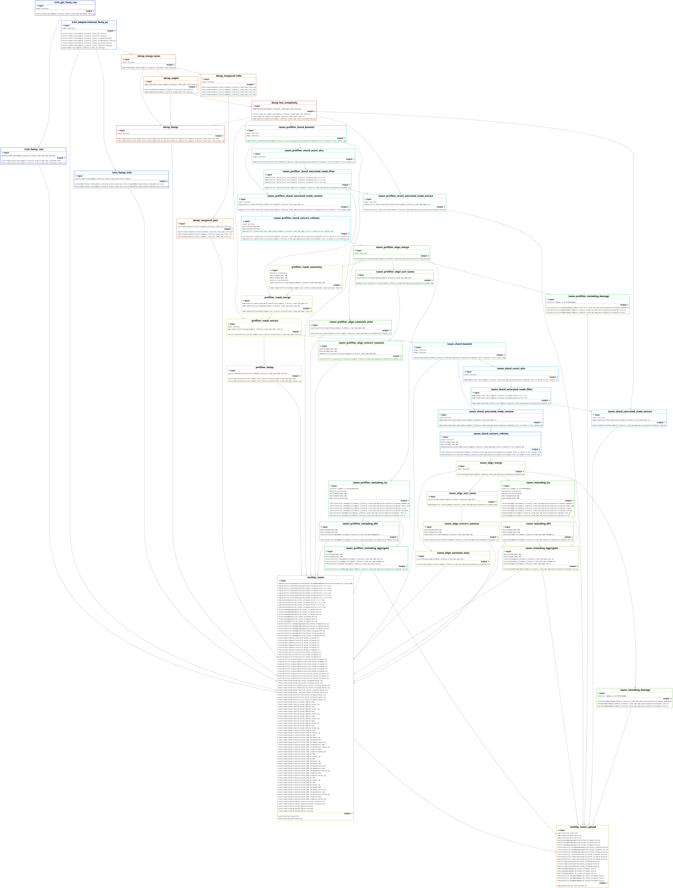
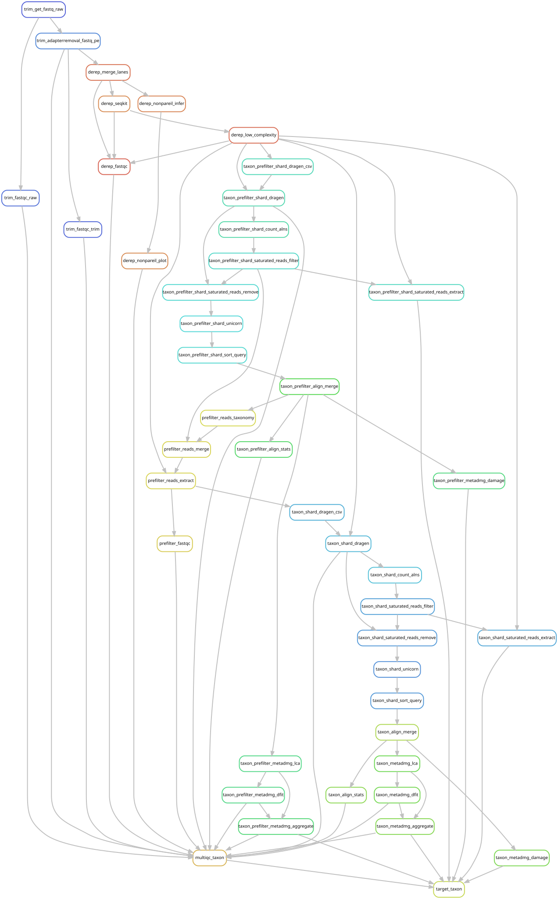
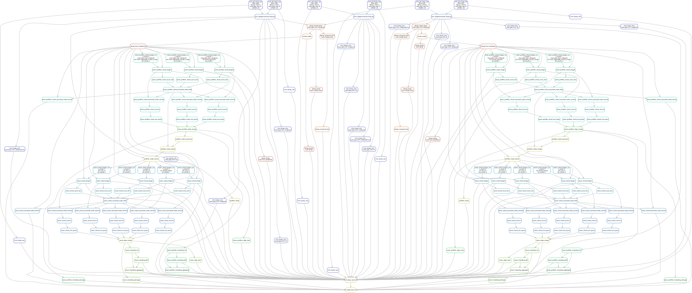
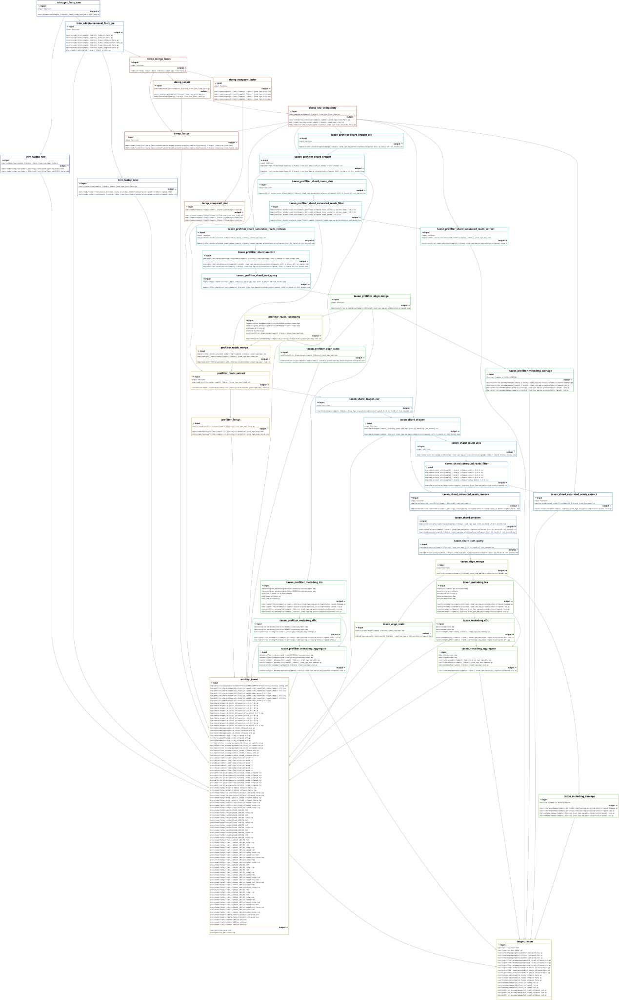
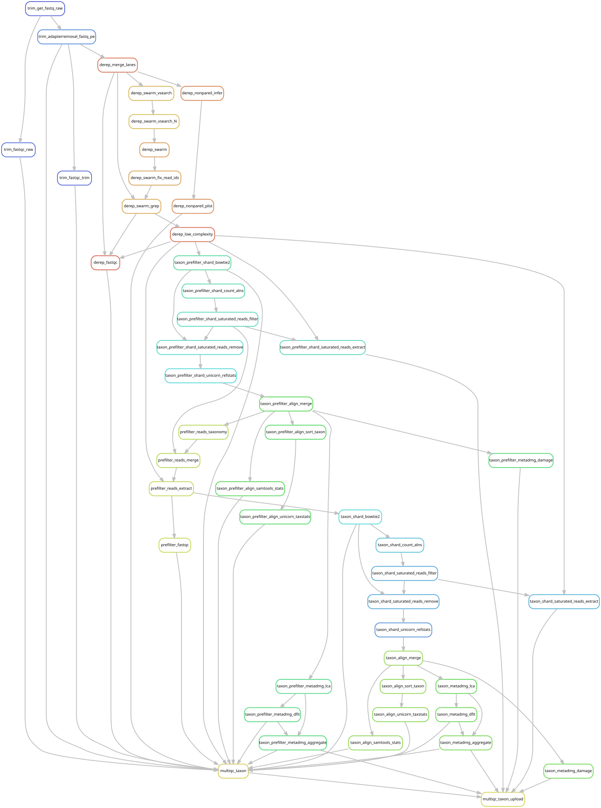
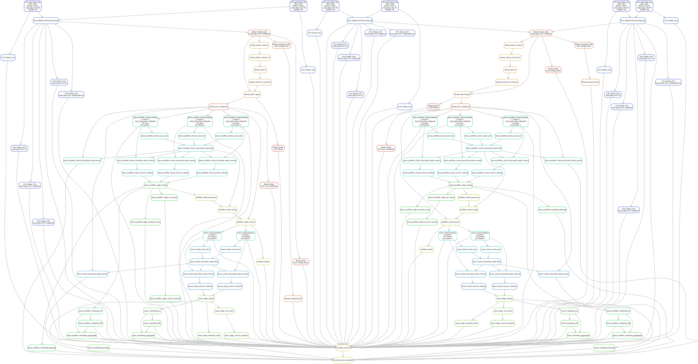
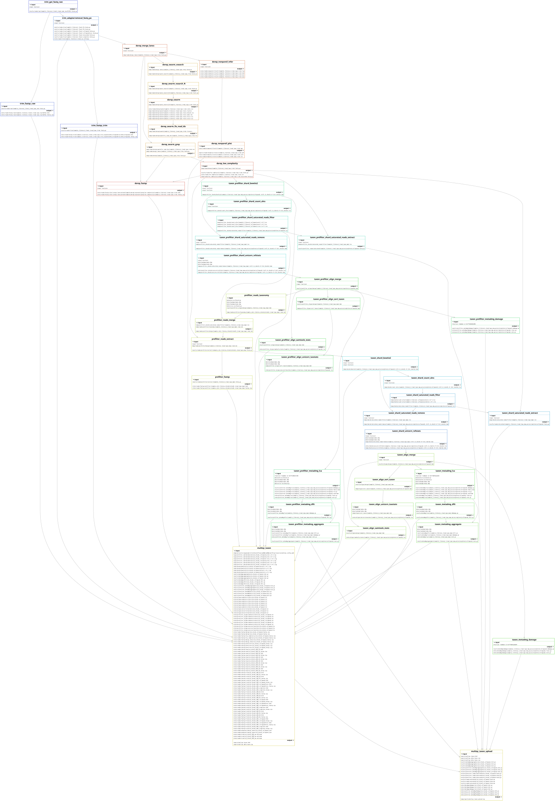

# Bowtie workflow for shotgun data - 1 sample (simulated) over 2 reference collections

Rulegraph

DAG

Filegraph

# DRAGEN workflow for shotgun data- 1 sample (simulated) over 2 reference collections

Rulegraph

DAG

Filegraph

# Bowtie2 workflow for capture data - 1 sample (simulated) over 2 reference collections

Rulegraph

DAG

Filegraph

